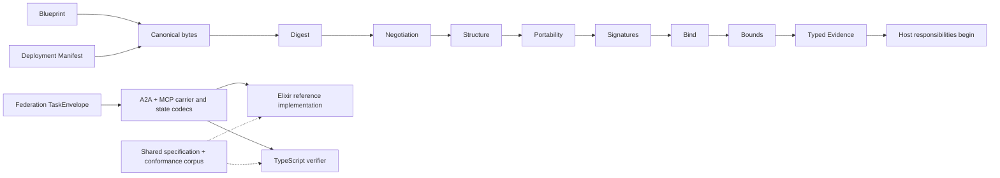

# Architecture

This guide is for implementers and host teams. You will learn how the three artifacts, two implementations, and shared conformance corpus fit together.

The protocol defines three artifact types: a Blueprint, a Deployment Manifest, and a Federation TaskEnvelope. Reconciliation consumes the first two. Federation decoding uses its own carrier and state codecs.

## Pipeline

Reconciliation runs the eight stages in the order shown: canonical, digest, negotiation, structure, portability, signatures, bind, then bounds. A failure returns a typed error. A successful pass returns Evidence.

The host's responsibilities begin after it receives the result. The host applies its own local policy and decides what to do with the evidence. Protocol success is not permission to act.

## Implementations and corpus

The Elixir package is the reference implementation. The TypeScript package implements the same published rules. Both consume the same specification and conformance corpus.

The corpus supplies shared inputs and expected projections. It lets maintainers compare both implementations and lets third parties check an independent implementation. A corpus pass establishes agreement for those cases. It does not establish behavior outside the corpus or any host behavior.

## Next steps

- [Run verification in continuous integration](verifying-in-ci.md)
- [Read the security model](security-model.md)
- [Read the full protocol](../spec/protocol.md)
